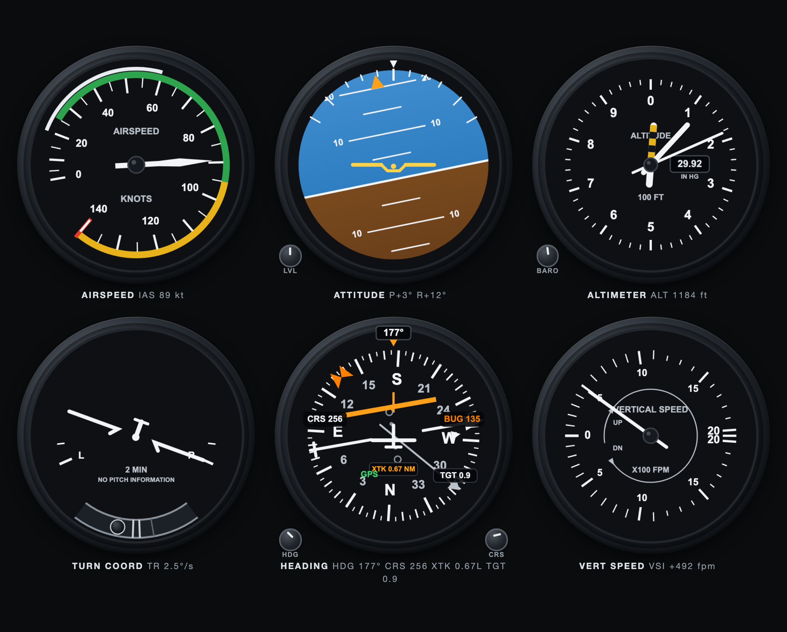

# Steam Six

Six Standard Steam gauges for all occasions. Take your instruments with you
in a browser tab, driven by what sensors you have available.
View your airspeed, attitude, altimeter, turn coordinator, heading, and
vertical speed. Any moving thing qualifies: cars, boats, tricycles, bicycles,
unicycles, trains obviously, or a walk back from the mailbox at a brisk 3 kt.

**See it Live:** https://steamsix.pages.dev

## A real problem

Most vehicles have instruments. Accurate instruments. Well lit,
connected to real sensors, and the manufacturer stands behind them.
Regrettably, some have no attitude indicator or refuse to display speed in
knots. Steam Six corrects this with a classic "six-pack" of analog flight
instruments, packaged into one little self-contained HTML file. Now the
browser's geolocation feed stands in for the pitot-static system: speed in
knots, GPS course as heading, altitude in feet, climb rate on the VSI. The
whole panel is one page and a service worker, about 60 KB. It works offline
after the first visit and maintains its dignity through tunnels (the service
worker caches the page, and the GPS feed re-arms after every failure).

## Pilot's Operating Handbook

1. Open it up in a browser and allow Location when prompted. GPS polling starts at
   page load and re-arms after every failure, so leaving a tunnel or fixing
   the permission in the address bar recovers without a reload.
2. Before the first fix the gauges rest at zero and the heading dial flags
   NO GS. Once GPS has reported a heading, the dial keeps showing it,
   parked included. At a standstill the GPS course is stale, not absent,
   much like the vehicle or a forgotten sandwich.

### Section 4: Knobs and things they do

Panel knobs, mounted at the gauge corners. They do things:

- **HDG** - heading bug. Drag to rotate, tap the edges to step 5°,
  double-tap to reset.
- **CRS** - course select. Turning it anchors a course line at the
  vehicle's position. Holding it while stationary re-anchors without
  turning. The deviation bar (CDI) shows cross-track distance from that
  line (0.25 NM full scale) with a TO/FROM triangle relative to the
  anchor point.
- **BARO** - Kollsman knob coupled to the needles like the real
  instrument: about 10 ft per 0.01 inHg and 1,000 ft per inHg, applied
  live, clamped to the real scale range 28.10-31.00, default 29.92. Now
  the dentist has a field elevation, and it is yours to dial in.

3. URL params preset the knobs and set the waypoint
   (see [URL parameters](#url-parameters)). Without `?tgt=` the first GPS fix
   becomes the waypoint, so the HSI always leads you home. With a target the
   HSI flies Garmin-style: a course pointer slaves to the direct bearing, a
   bearing pointer rides the dial, distance goes target-relative, the CRS
   knob goes inert, holding CRS enters OBS mode, and tapping the TGT plate
   re-activates direct.
4. The panel scales to the browser window, from a narrow split view up to a
   large portrait screen, capped at what fits without vertical scrolling.
5. The footer streams the raw geolocation data: lat, lon, accuracy,
   altitude, altitude accuracy, heading, speed, fix age. A dash marks any
   field the browser is not providing. The needles can be audited.
6. On a phone, tilt and compass sensors drive the attitude indicator and
   supply heading while parked (iOS needs one tap on ENABLE MOTION). Any
   rigid mount works: portrait, landscape, upside down. A phone lying flat
   declines to guess and falls back to the GPS-derived attitude.
7. The **LVL** knob on the attitude indicator calibrates out mount tilt.
   Tap it while the vehicle sits level and that attitude becomes
   straight-and-level. It persists across reloads. Press and hold to clear.
   Calibration stays manual: crowned roads, hills, and parking slopes bias a
   long-term gravity mean, and a horizon that drifts silently is worse than
   a fixed mount offset.

## URL parameters

| Param | Takes | Default | Effect |
|---|---|---|---|
| `?bug=` | degrees, 0-360 | 135 | heading bug position |
| `?crs=` | degrees, 0-360 | 90 | course pointer until the direct leg activates, then superseded; OBS mode still turns it |
| `?baro=` | inHg, 28.10-31.00 | 29.92 | Kollsman window and the needle offset |
| `?tgt=` | `lat,lon`, signed decimal degrees | first GPS fix | the HSI waypoint. Malformed values are ignored |

## Data mapping

"But wait!" I hear you say. "Sure, my moped has GPS and a web browser,
but a 6DoF accelerometer is a bridge too far! Where are you getting these
_gyroscopic_ readings?"

The old fashioned way, pilgrim. With lies.

| Gauge | Source |
|---|---|
| Airspeed | `coords.speed` m/s -> kt |
| Heading / CDI | `coords.heading`, last reported value at standstill; phone magnetic heading below ~5 kt; CDI = cross-track distance from the course line anchored where CRS was set |
| Altitude | `coords.altitude` m -> ft, Kollsman-coupled to the BARO knob (indicated = true + baro offset) |
| VSI | least-squares slope of altitude over a rolling 12 s window, weighted by reported altitude accuracy (1/sigma^2); an altitude step past a 4-sigma gate re-baselines the window; capped at a 25% grade x groundspeed; eased to zero below ~5 kt or on a stale fix |
| Turn coordinator | heading-delta rate |
| Attitude | phone device orientation when present (gravity-vector based); otherwise approximated: pitch = flight-path angle, bank = coordinated-turn bank, both from GPS regressions; eases level below ~5 kt, without speed, or on a stale fix |

## Objections, anticipated

**Doesn't my car already have instruments?** It does, and they work. What it
lacks is a turn coordinator, a Kollsman knob, or representations of your
cross-track error. Steam Six supplies all three, plus a VSI, which is how
you will finally learn how fast the parking garage ramp descends.

**Can I navigate by it?** No. It would be insane to trust consumer GPS, uncertified code,
and a driver who is clearly not paying attention. The CDI math is real. The certifying
authorities were not consulted. Do not fly your boat this way.

**Does it work in an actual airplane?** I mean... maybe? GPS keeps receiving
with the phone in airplane mode usually, so from a passenger seat you can run the
same six gauges as the folks up front at a fraction of the panel weight and
with many times the inaccuracy. The attitude indicator even agrees with the
horizon most of the time.

**Why knots?** Why not?! This is an instrument panel, and instruments in panels
speak knots. Anything else is just a dashboard. Boats at least get this right, but trains
and trikes consistently muck it up. Your car may never extend its flaps or rotate. Its V-speeds
can still be aspirational.

**Is it expensive?** You should expect to pay ten, twenty, even seventy
thousand dollars for a panel with these full-color features. Friends, if you act today, it can
be yours for the low, low price of one (1) GitHub star.

## Technical notes

- One draw module per gauge (`drawASI/AI/ALT/TC/HI/VSI`) painting two
  canvases. Each instrument follows its real counterpart's presentation.
- Phone orientation sensors, when the browser provides them, take precedence
  over the GPS-derived attitude. Browsers without sensor events fall back to
  the GPS-derived ~~lies~~ approximations.
- `sw.js` caches the page. Deployments bump the cache name (`steamsix-vN`)
  so returning clients should pick up any new builds.

## License

MIT. See [LICENSE](LICENSE).
